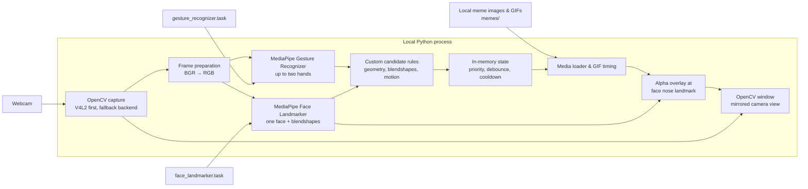

# reM — gesture-triggered webcam memes


**reM is a local desktop webcam app that recognizes facial expressions and hand poses, then overlays the matching image or GIF meme on the detected face in real time.**

It is for playful, camera-based interaction experiments—not a web service or cloud-hosted product. Camera frames, inference, media, and display remain on the local machine.

## Table of contents

- [Overview](#overview)
- [What makes it special](#what-makes-it-special)
- [System architecture](#system-architecture)
- [Recognition and media flow](#recognition-and-media-flow)
- [Supported gestures](#supported-gestures)
- [Installation and development](#installation-and-development)
- [Usage](#usage)
- [Configuration](#configuration)
- [OBS](#obs)
- [Testing](#testing)
- [Project structure](#project-structure)
- [Troubleshooting and limitations](#troubleshooting-and-limitations)
- [License](#license)

## Overview

reM opens a webcam feed in an OpenCV window titled **`meme camera`**. It uses the bundled MediaPipe Gesture Recognizer and Face Landmarker models to inspect each frame, maps a recognized pose or expression to configured local media, and alpha-blends that asset around the face's nose landmark.

The application is a single local Python process:

- **Input:** webcam frames.
- **Inference:** MediaPipe hand gestures, hand landmarks, facial landmarks, and face blendshapes.
- **Decisioning:** custom gesture rules with priority, debounce, consumption, and cooldown state.
- **Output:** a mirrored OpenCV camera view with a local image or looping GIF overlay.

There is no browser frontend, HTTP API, database, account system, remote storage, or external inference service.

## What makes it special

- **Layered recognition.** MediaPipe output is combined with landmark geometry, blendshape thresholds, and recent hand-motion history to distinguish face-relative poses such as hands on cheeks, hands on face, a T sign, and a vertical wave.
- **Conflict-aware activation.** Simultaneous candidates compete by explicit priority; the chosen candidate must hold through its configured debounce period before its meme activates.
- **Responsive local pipeline.** Gesture and face inference run concurrently in a two-thread executor. Face inference runs every other frame after initialization, while a recent valid face can briefly bridge tracking dropouts.
- **Scene-aware media.** Images and GIFs are decoded at startup, normalized to BGRA, resized to a fixed width, and alpha-blended with frame-edge clamping.
- **Interaction safeguards.** An active meme blocks competitors; triggered gestures are consumed until they clear; cooldowns prevent immediate retriggers; <kbd>h</kbd> dismisses media until all current candidates clear.

## System architecture



## Recognition and media flow

```mermaid
sequenceDiagram
    participant C as Webcam
    participant R as Runtime loop
    participant G as Gesture Recognizer
    participant F as Face Landmarker
    participant A as Candidate arbitration
    participant M as Media overlay
    participant W as OpenCV window

    C->>R: BGR frame
    R->>R: Keep original; mirror display frame
    par Gesture inference
        R->>G: RGB frame + monotonic timestamp
    and Face inference
        R->>F: RGB frame + timestamp (initially, then every second frame)
    end
    G-->>R: Hand landmarks, handedness, gesture categories
    F-->>R: Face landmarks and blendshapes
    R->>A: Evaluate configured candidates
    A->>A: Select highest-priority eligible gesture; debounce
    alt Candidate activates
        A-->>M: Active media + expiry
        M->>M: Select image or looping GIF frame
        M->>W: Alpha-blend near nose landmark
    end
    R->>W: Show mirrored frame
```

### Runtime details

1. The camera is opened at **index 1** by default. The runtime tries V4L2 on Linux first, then OpenCV's default backend. It requests MJPG, 640×480, and a capture buffer size of 1.
2. The unmirrored frame is used for inference; a horizontally flipped frame is displayed. Inputs larger than the configured capture dimensions are resized to 640×360 before inference.
3. Gesture Recognizer runs for up to two hands on each detection-enabled frame. Face Landmarker runs initially and then every second frame; its latest valid face is retained for up to 0.5 seconds.
4. Rules produce candidates only when a face is available. A 0.5-second hand-motion history supports movement-based gestures.
5. The highest-priority eligible candidate activates after its debounce interval. Static images are held for at least two seconds; GIFs for at least five seconds; each selected gesture then enters its own cooldown.
6. The active frame is centered on facial landmark `1` (the nose), clipped to frame bounds, and alpha-blended into the displayed image.

## Supported gestures

The active mappings live in [`rem/config.py`](rem/config.py). When multiple gestures match, the larger priority wins.

| Name | Activation | Media | Priority |
| --- | --- | --- | ---: |
| `hands_on_face` | Palms together or middle fingertips meeting over the nose/mouth, fingers upward; confirmed for three frames | `hands_on_face.jpg` | 90 |
| `head_grab` | Palms above the eye region on opposite sides of the nose | `headgrab.jpeg` | 89 |
| `hands_on_cheeks` | Separated palms in opposite cheek zones below the eyes | `cheeks.jpeg` | 87 |
| `t_sign` | Two nearby open hands forming an approximate T | `T_sign.jpg` | 85 |
| `explaining_hands` | Both hands moving while neither is near the nose | `hands_talking_to_wall.gif` | 80 |
| `left_nose_right_wave` | Left hand near the nose plus a vertical right-hand wave | `dance_fox_hands_forward_wave_with_nose_touch.gif` | 60 |
| `mouth_round` | Puckered mouth with a slightly open jaw | `mouth_round.jpg` | 55 |
| `horse_smirk` | Pronounced one-sided smile | `horse_smirk.jpg` | 50 |
| `eyes_closed` | Both eyes closed or almost closed | `master_piece_squiting_too_much.jpg` | 45 |
| `tongue_out` | Mouth-opening landmark distance exceeds the configured threshold | `dog_tongue_out.jpg` | 40 |
| `smile` | Even smile with both mouth corners raised | `smile_dog.jpg` | 35 |
| `lips_down` | Both mouth corners pulled down | `beluga.jpg` | 30 |
| `open_palm` | MediaPipe recognizes an open palm away from the face | `hold_up_hand_forward.jpg` | 10 |

`t_sign` suppresses `open_palm`; while `explaining_hands` is active, a hands-on-face, cheeks, or head-grab candidate cancels it.

## Installation and development

### Prerequisites

- Python **3.12+** (the repository pins 3.12 in [`.python-version`](.python-version)).
- [`uv`](https://docs.astral.sh/uv/) for the locked development workflow.
- An accessible webcam and graphical desktop session for the OpenCV window.
- On Linux, camera permission for the current user. Many distributions use the `video` group:

  ```sh
  sudo usermod -aG video "$USER"
  ```

  Log out and back in after changing group membership.

The current runtime requires these repository-root model files:

- `gesture_recognizer.task`
- `face_landmarker.task`

The capture and Qt setup are Linux-oriented: V4L2 is attempted first and `QT_QPA_PLATFORM` defaults to `xcb` unless already set.

### Install dependencies

```sh
uv sync
```

This installs the dependencies declared in [`pyproject.toml`](pyproject.toml): MediaPipe, OpenCV, and Pillow.

### Start the app

```sh
uv run python main.py
```

### Debug mode

```sh
uv run python main.py --debug
```

Debug mode draws face/hand landmarks and pose state in the preview and prints live detection metrics. The runtime periodically prints FPS and average gesture/face inference time.

## Usage

### In-window controls

| Key | Action |
| --- | --- |
| <kbd>d</kbd> | Toggle detection. Reset media, candidates, cooldowns, consumed gestures, hand history, and cached face state. |
| <kbd>h</kbd> | Dismiss active media and suppress a new activation until current candidates clear. |
| <kbd>q</kbd> or <kbd>Esc</kbd> | Quit the app. |

### Discover configured mappings

List each configured name, media filename, and priority without opening the camera:

```sh
uv run python main.py --list-memes
```

Describe one mapping:

```sh
uv run python main.py --describe-meme smile
```

`--list-memes` and `--describe-meme NAME` are mutually exclusive discovery commands. Use a name printed by `--list-memes` for `--describe-meme`.

### Change the camera

There is no camera-index CLI option. Change `CAMERA_INDEX` in [`rem/config.py`](rem/config.py) and restart the app; `0`, `1`, and `2` are useful values to try when the wrong camera opens.

### Add or change a meme mapping

1. Add an image or GIF under [`memes/`](memes/).
2. Add or update its `MediaConfig` entry in `GESTURE_MEDIA` in [`rem/config.py`](rem/config.py). Entries declare the file, media type, duration, cooldown, priority, and debounce period.
3. Add the activation text to `MEME_DESCRIPTIONS`.
4. Implement or update the candidate rule in [`rem/actions/`](rem/actions/), then evaluate it in [`detect_candidates`](rem/actions/candidates.py).
5. Add a regression test in [`tests/test_actions.py`](tests/test_actions.py) for the intended match and relevant conflicts.

Every configured asset is validated and decoded at startup. A missing or undecodable file stops the app with an error.

## Configuration

Runtime behavior is configured in code, not an environment file. [`rem/config.py`](rem/config.py) is the source of truth for model/media paths, camera settings, thresholds, timing, key bindings, and mappings.

| Setting group | Current behavior |
| --- | --- |
| Models | Repository-root `gesture_recognizer.task` and `face_landmarker.task`. |
| Camera | Camera index 1; requests 640×480, MJPG, and capture buffer size 1. |
| Inference | Gesture Recognizer for two hands; Face Landmarker for one face with blendshapes; two in-process worker threads. |
| Face fallback | Reuses the last detected face for up to 0.5 seconds. |
| Media | Resizes assets to 320 pixels wide; supports static images and GIFs. |
| Gesture timing | Each mapping declares `duration`, `cooldown`, `priority`, and `debounce`; image/GIF minimum active durations are enforced globally. |

There are **no application-specific environment variables**. The source only defaults `QT_QPA_PLATFORM` to `xcb` when it has not already been defined.

## OBS

reM renders the completed overlay inside `meme camera`. Capture that window in OBS rather than having OBS and reM open the physical webcam at the same time. The overlay is already baked into the captured window; no OBS filter is required.

For window-capture steps, X11/Wayland guidance, virtual-camera use, audio, and common capture fixes, see [the OBS guide](docs/OBS.md).

## Testing

The repository uses Python's standard-library `unittest`. The current suite covers pose distinctions, hands-on-face confirmation, T-sign suppression, and debounce activation.

```sh
uv run python -m unittest discover -s tests
```

## Project structure

```text
reM/
├── main.py                    # CLI: run, list mappings, describe mapping
├── pyproject.toml             # Python metadata and runtime dependencies
├── gesture_recognizer.task    # Bundled MediaPipe gesture model
├── face_landmarker.task       # Bundled MediaPipe face model
├── memes/                     # Local image and GIF assets
├── docs/
│   ├── OBS.md                 # OBS capture and virtual-camera guidance
│   └── TROUBLESHOOTING.md     # Setup, camera, tracking, and performance fixes
├── rem/
│   ├── config.py              # Thresholds, timings, controls, and mappings
│   ├── runtime.py             # Camera loop, MediaPipe setup, inference
│   ├── media.py               # Image/GIF decoding, timing, alpha overlay
│   ├── models.py              # In-memory runtime and media data models
│   ├── debug.py               # Debug drawing and metrics
│   └── actions/               # Candidate rules, geometry helpers, state machine
└── tests/
    └── test_actions.py        # Candidate/arbitration unit tests
```

## Troubleshooting and limitations

- For dependency, camera, window/Qt, MediaPipe, gesture, performance, and OBS help, see [Troubleshooting](docs/TROUBLESHOOTING.md).
- The project is designed around a local graphical webcam workflow; cross-platform compatibility is not established.
- Recognition thresholds are heuristics configured in code. The repository provides no accuracy benchmarks or calibration automation.
- The app relies on the bundled MediaPipe models and configured local media assets being present.
- Asset and model provenance is not documented in this repository.

## License

Copyright © 2026 Suho Kim. Licensed under the [MIT License](LICENSE).
